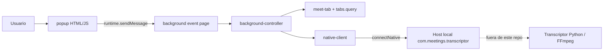
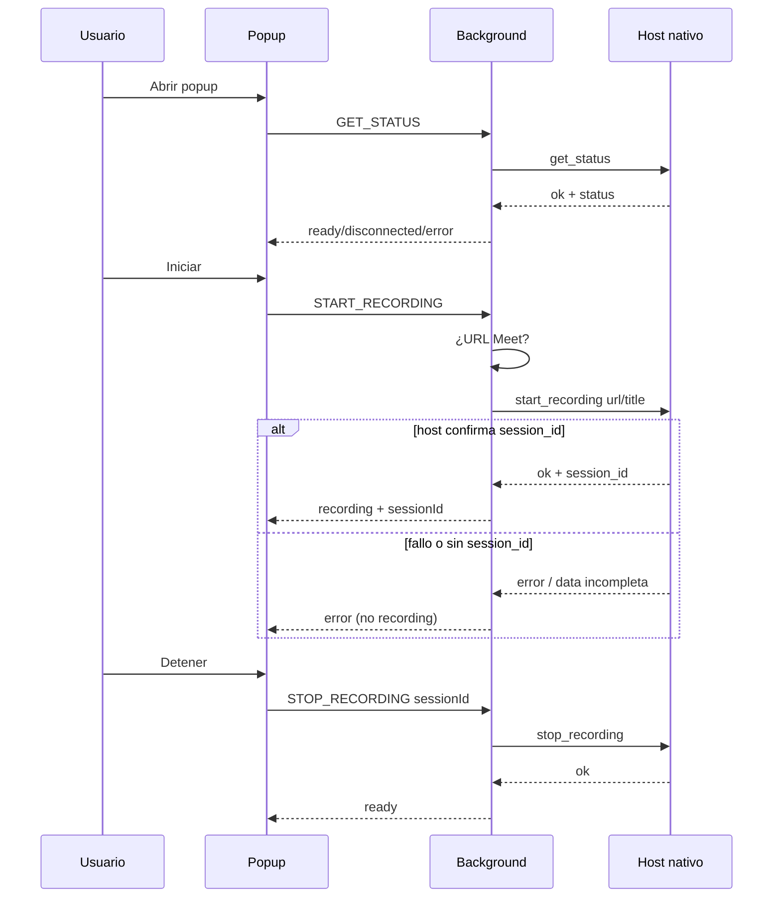

# Arquitectura

Documento de la arquitectura **efectiva** de la extensión v0.1.0.

## Vista general



## Manifest y permisos

- Manifest V3.
- ID fijo: `meetings-transcriptor@example.org`.
- `strict_min_version`: Firefox 121.
- Background: `background.page` → `background/background.html` (event page Firefox). **No** se usa `service_worker`.
- Permisos: `nativeMessaging`, `activeTab`.
- Sin `host_permissions`, sin content scripts, sin `optional_permissions`.

## Popup e interfaz

Archivos: `popup/popup.html`, `popup/popup.css`, `popup/popup.js`.

Al abrir:

1. Estado inicial vía `createInitialState()` → desconectado.
2. `GET_STATUS` al background.
3. `applyBackgroundResult` + `derivePopupView` actualizan labels y botones.

La UI **no** habla con Native Messaging directamente.

## Background

`background/background.js` solo:

- crea el `NativeClient` real (`browser.runtime.connectNative`);
- obtiene la pestaña activa con `browser.tabs.query`;
- delega en `shared/background-controller.js`;
- escucha `browser.runtime.onMessage`.

## Content scripts

No existen en esta versión. La detección Meet es por URL de la pestaña activa.

## Cliente Native Messaging

`shared/native-client.js`:

- Conexión perezosa al host `com.meetings.transcriptor`.
- Solicitudes con `request_id` único.
- Timeout configurable (default 10s).
- Ignora mensajes sin pending matching.
- Rechaza start exitoso sin `session_id`.
- Propaga desconexiones a promesas pendientes.

`shared/protocol.js` define el contrato v1 (`get_status`, `start_recording`, `stop_recording`).

## Contrato de mensajes extensión interna

Popup → Background:

| `type`            | Efecto                                        |
| ----------------- | --------------------------------------------- |
| `GET_STATUS`      | Consulta host + describe pestaña              |
| `START_RECORDING` | Solo si pestaña Meet; envía url/title al host |
| `STOP_RECORDING`  | Envía `session_id` al host                    |
| `PROTOCOL_INFO`   | Metadatos de protocolo (diagnóstico)          |

Respuesta típica al popup:

```json
{
  "ok": true,
  "tab": {
    "onMeet": true,
    "url": "...",
    "title": "...",
    "label": "Google Meet"
  },
  "transcriptorStatus": "ready",
  "sessionId": null
}
```

Errores: `ok: false` + `error: { code, message }` y un `transcriptorStatus` de `disconnected` o `error`.

## Flujo de inicio y detención



## Límites con el transcriptor local

- Este repo no inicia FFmpeg ni escribe WAV/MP4.
- Si el host no está registrado, la extensión permanece usable como UI de diagnóstico (estado desconectado + mensaje).
- La integración real de grabación queda validada solo cuando existe un host conforme al protocolo; hasta entonces no se debe afirmar grabación real end-to-end.
