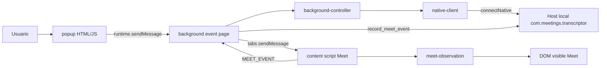

# Arquitectura

Documento de la arquitectura **efectiva** de la extensión v0.3.2.

## Vista general

## Manifest y permisos

- Manifest V3.
- ID fijo: `meetings-transcriptor@example.org`.
- Background: `background.page` → `background/background.html`.
- Permisos: `nativeMessaging`, `activeTab`.
- `host_permissions`: solo `https://meet.google.com/*`.
- Content scripts solo en Meet (cargan idle; observan únicamente tras `START_MEET_OBSERVATION`).

## Popup

Archivos: `popup/popup.html`, `popup/popup.css`, `popup/popup.js`.

- Control start/stop + estado.
- Selector de perfil de grabación (vía `list_profiles` / `profile` en start).
- Modo diagnóstico en memoria (últimos eventos).
- Detalle del contrato de perfiles: [`docs/PROFILES.md`](./docs/PROFILES.md).

## Background

- Native Messaging privilegiado.
- Al confirmar start: notifica al content script.
- Al stop (o host ya no recording): detiene observación.
- Reenvía `MEET_EVENT` validados como `record_meet_event`.

## Content script

Scripts en `shared/meet-*.js` + `content/content.js`.

- Polling ~2 s + MutationObserver acotado a la lista de participantes si existe.
- No observa el `document` completo sin límites.
- Emite eventos tipados; no inventa nombres.

## Módulos compartidos clave

| Módulo                                              | Rol                               |
| --------------------------------------------------- | --------------------------------- |
| `meet-event-schema.js`                              | Contrato de evento                |
| `meet-dom-snapshot.js`                              | Extracción heurística del DOM     |
| `meet-participant-diff.js` / `meet-speaker-diff.js` | Diffs                             |
| `meet-observation.js`                               | Lifecycle + rate limit            |
| `protocol.js` / `native-client.js`                  | NM incluyendo `record_meet_event` |

## Contrato interno (popup/content → background)

| `type`                                              | Efecto                                                                |
| --------------------------------------------------- | --------------------------------------------------------------------- |
| `GET_STATUS` / `START_RECORDING` / `STOP_RECORDING` | Estado (incl. `transcribing` + progreso); stop con `transcribe`       |
|                                                     | Detalle: [`docs/TRANSCRIBE_ON_STOP.md`](./docs/TRANSCRIBE_ON_STOP.md) |
| `SET_PREFERRED_PROFILE`                             | Recuerda el perfil elegido en el background                           |
| `MEET_EVENT`                                        | Content → background → host                                           |
| `SET_DIAGNOSTIC` / `GET_DIAGNOSTICS`                | Buffer en memoria                                                     |
| `START_MEET_OBSERVATION` / `STOP_MEET_OBSERVATION`  | Background → content                                                  |

Detalle de eventos y fiabilidad: [`docs/MEET_EVENTS.md`](./docs/MEET_EVENTS.md).

## Límites con el transcriptor local

- Este repo no inicia FFmpeg ni escribe WAV/MP4.
- La persistencia de eventos Meet la hará el host al implementar `record_meet_event`.
- WhisperX corre en el host tras `stop_recording` con `transcribe: true`; el
  progreso se consulta con `get_status` (no hay asociación visual hablante↔WhisperX).
